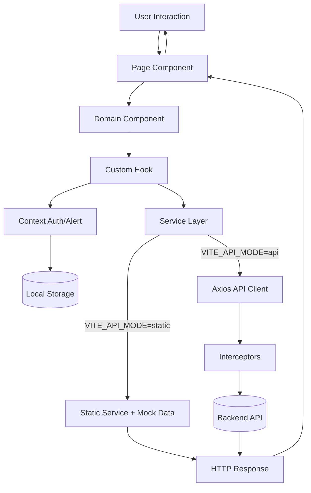

# Architecture Overview

## 1. High-Level Components

The frontend is a React single-page application (SPA) organized by domain and shared infrastructure layers.

### Presentation Layer

- `src/pages`: Route-level screens (Dashboard, Tourists, Guides, Trips, Users, Finance)
- `src/components`: Reusable UI and domain-specific building blocks
- `src/styles`: Global styles and design tokens

### Application Layer

- `src/context`: Global state providers (`AuthContext`, `AlertContext`)
- `src/hooks`: Reusable behavior (`useAuth`, `useAlert`, pagination, responsive helpers)
- `src/config`: Static configuration for constants, RBAC, routes

### Data Layer

- `src/services/api`: Axios-based clients for real backend calls
- `src/services/static`: Mock services for local/demo usage
- `src/services/index.js`: Service mode factory (`static` vs `api`)
- `src/utils/storage.js`: Token/user persistence utility

## 2. System Interaction and Data Flow

## 3. Request Lifecycle (API Mode)

1. A page or hook triggers a service call.
2. Service client sends request through Axios.
3. Request interceptor injects:
   - `Authorization: Bearer <token>` when available
   - `Accept-Language` from i18n state
4. Backend returns response.
5. Response interceptor normalizes to `response.data`.
6. UI updates state and renders success/error feedback.

## 4. Authentication and Authorization

### Authentication

- Auth is managed via `AuthContext`.
- User token and profile are persisted via storage utility.
- Current flow supports OTP verification after password verification.

### Authorization (RBAC)

- Roles: `admin`, `manager`, `operations`, `finance`, `viewer`
- Route-level protection through `ProtectedRoute`
- Permission-based UI behavior through role-permission mapping in `src/config/permissions.js`

## 5. Routing Strategy

- Public routes: login, forgot-password, reset-password, errors
- Protected routes: dashboard and all business modules
- Main shell (`MainLayout`) wraps authenticated route tree
- Fallback route redirects unknown paths to `404`

## 6. Design Patterns Used

- SPA + Client-Side Routing
- Context Provider Pattern for global state
- Service Abstraction Pattern (`static`/`api` mode swap)
- Interceptor Pattern for cross-cutting HTTP concerns
- RBAC (Role-Based Access Control)
- Domain-Driven UI organization (tourists/guides/trips/users/finance)

## 7. Non-Functional Architecture Notes

- Mobile-first responsive UI with Tailwind utilities
- Internationalization-ready structure (English/Arabic resource files)
- Clear separation between presentation and data access concerns
- Mock-first development path for backend-independent progress
